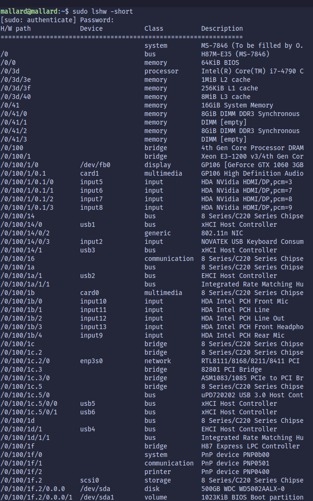
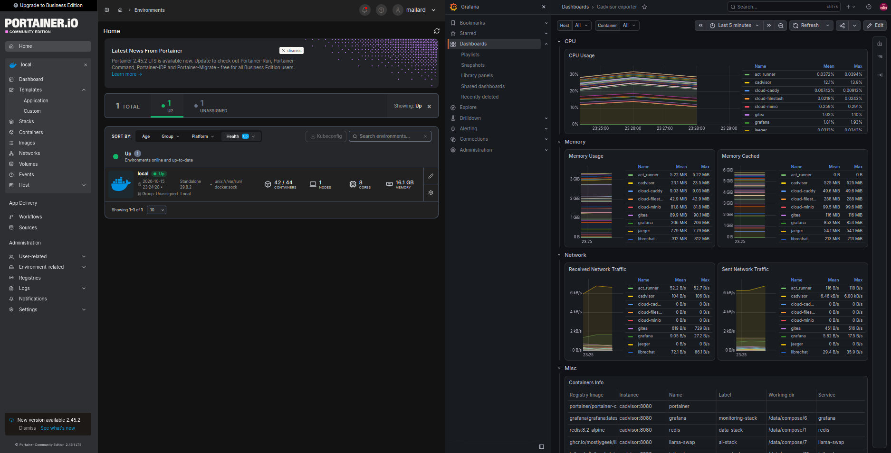

# Mallard Infrastructure Home Lab Ecosystem
## Current-State Infrastructure & Full-Stack Architecture

> **Last Updated:** 2026-10-15
> **Host:** `mallardserver2`
> **Local IP:** `192.168.1.121`
> **Purpose:** Self-hosted backend engineering, DevOps, infrastructure, observability, AI, project management, storage, and networking laboratory.
> **Source of truth:** `docker ps` snapshot (42 running containers)

---

## 1. Executive Overview

This document describes the **current deployed state** of the Mallard Homelab running on `mallardserver2`, based on active container introspection.

The environment is built on Docker and Docker Compose, with Portainer for container management. Traefik is the primary reverse proxy and edge router (`:80`, `:8089`). Plane is the central project management platform and ships with its own Caddy proxy (`plane-proxy`, `:8092`). Local DNS is served by Pi-hole using the `.mallard` naming convention, and Tailscale provides remote mesh access.

### Active stacks

- `devops-stack` (Traefik, Portainer, Gitea, act_runner)
- `data-stack` (PostgreSQL, MongoDB, Redis, RabbitMQ, pgAdmin, mongo-express, RedisInsight)
- `monitoring-stack` (Grafana, Prometheus, Loki, Promtail, Jaeger, OTel Collector, cAdvisor, Node Exporter, NVIDIA GPU Exporter)
- `ai-stack` (LibreChat, llama-swap, SearXNG, n8n)
- `plane-stack` (Plane and its dedicated backing services)
- `dns-stack` (Pi-hole)
- `cloud-stack` (Filestash, Caddy, MinIO)
- `sftp-stack` (SFTP)
- `vpn-stack` (Tailscale)

### Changes since 2026-09-05

| Change | Detail |
|---|---|
| **Added** | `searxng`, `redisinsight`, `cadvisor` (now in table), full Plane stack breakdown |
| **Replaced** | `llama-cpp` → `llama-swap` (`ghcr.io/mostlygeek/llama-swap:cuda`, `:11435` → `:8080`) |
| **Image change** | MinIO now runs `pgsty/minio:RELEASE.2026-08-04T00-00-00Z` (was `minio/minio:latest`) |
| **Not running** | `keycloak`, `netdata`, `localai`, `ntfy`, `docker-volume-backup` |
| **Port corrections** | pgAdmin `:5050`, cloud-caddy `:8480` / `:8444`, cloud-minio `:9000-9001` |

---

## 2. Hardware & Host System

| Component | Specification |
|---|---|
| **Host System** | `mallardserver2` |
| **Local IP** | `192.168.1.121` |
| **CPU** | Intel Core i7-4790, 3.60–4.00 GHz |
| **GPU** | NVIDIA GeForce GTX 1060 3GB |
| **RAM** | 16 GB |
| **Operating System** | Ubuntu Server 26.04 LTS |
| **Container Engine** | Docker Engine |
| **Container Orchestration** | Docker Compose |
| **Container Management** | Portainer CE |
| **Primary Storage** | Local host storage |
| **SFTP Storage** | `/data/ftp` |
| **Download Staging** | `/data/downloads` |
| **Backup Storage** | `/data/backups` |
| **Docker Volumes** | `/var/lib/docker/volumes` |



---

## 3. Active Containers



### 3.1 DevOps & Edge

| Container | Image / Version | Host Ports → Container | Purpose |
|---|---|---|---|
| `traefik` | `traefik:v3.6.16` | `80`, `8089` | Edge router / reverse proxy |
| `portainer` | `portainer/portainer-ce:latest` | `9443`, `8000` | Container management |
| `gitea` | `gitea/gitea:1.21-rootless` | `3001` → `3000`, `2222` | Git hosting (HTTP + SSH) |
| `act_runner` | `gitea/act_runner:latest` | none | CI/CD runner for Gitea |
| `pihole` | `pihole/pihole:latest` | `53` (TCP/UDP), `8088` → `80` | DNS filtering + local `.mallard` DNS |
| `tailscale` | `tailscale/tailscale:latest` | none | Mesh VPN node |

### 3.2 Data Layer

| Container | Image / Version | Host Ports → Container | Purpose |
|---|---|---|---|
| `postgres` | `postgres:18-alpine` | `5433` → `5432` | Primary PostgreSQL |
| `pgadmin` | `dpage/pgadmin4:9.17` | `5050` → `80` | PostgreSQL web client |
| `mongodb` | `mongo:7.0` | `27017` | MongoDB backend |
| `mongo-express` | `mongo-express:latest` | `8081` | MongoDB admin UI |
| `redis` | `redis:8.2-alpine` | `6379` | Cache |
| `redisinsight` | `redis/redisinsight:latest` | `5540` | Redis GUI |
| `rabbitmq` | `rabbitmq:4.2-management-alpine` | `5672`, `15672` | Message broker + management UI |

### 3.3 Monitoring & Observability

| Container | Image / Version | Host Ports → Container | Purpose |
|---|---|---|---|
| `grafana` | `grafana/grafana:latest` | `3000` | Dashboards |
| `prometheus` | `prom/prometheus:latest` | `9090` | Metrics scraping |
| `loki` | `grafana/loki:latest` | internal `3100` | Log aggregation |
| `promtail` | `grafana/promtail:latest` | none | Log collection agent |
| `jaeger` | `jaegertracing/all-in-one:latest` | `16686` | Distributed tracing UI |
| `otel-collector` | `otel/opentelemetry-collector-contrib:0.104.0` | `4317-4318` | OpenTelemetry collector (OTLP gRPC/HTTP) |
| `cadvisor` | `gcr.io/cadvisor/cadvisor:latest` | internal `8080` | Container metrics |
| `node-exporter` | `prom/node-exporter:latest` | none (host metrics) | Host system exporter |
| `nvidia-gpu-exporter` | `utkuozdemir/nvidia_gpu_exporter:latest` | internal `9835` | GPU telemetry |

### 3.4 AI & Automation

| Container | Image / Version | Host Ports → Container | Purpose |
|---|---|---|---|
| `llama-swap` | `ghcr.io/mostlygeek/llama-swap:cuda` | `11435` → `8080` | Local LLM server with on-demand model swapping (CUDA) |
| `librechat` | `ghcr.io/danny-avila/librechat:latest` | `3080` | Multi-model chat UI |
| `searxng` | `searxng/searxng:latest` | internal `8080` | Private metasearch (web search for chat) |
| `n8n` | `n8nio/n8n:latest` | `5678` | Workflow automation |

### 3.5 Plane Project Management (`plane-stack`)

| Container | Image / Version | Host Ports → Container | Purpose |
|---|---|---|---|
| `plane-proxy` | `makeplane/plane-proxy:stable` | `8092` → `80` | Caddy entry point for Plane |
| `plane-stack-web-1` | `makeplane/plane-frontend:stable` | internal | Web frontend |
| `plane-stack-admin-1` | `makeplane/plane-admin:stable` | internal | Admin (God Mode) UI |
| `plane-stack-space-1` | `makeplane/plane-space:stable` | internal | Public spaces UI |
| `plane-stack-live-1` | `makeplane/plane-live:stable` | internal | Realtime collaboration |
| `plane-stack-api-1` | `makeplane/plane-backend:stable` | internal `8000` | API |
| `plane-stack-worker-1` | `makeplane/plane-backend:stable` | internal | Background worker |
| `plane-stack-beat-worker-1` | `makeplane/plane-backend:stable` | internal | Scheduled tasks (Celery beat) |
| `plane-stack-plane-db-1` | `postgres:15.7-alpine` | internal `5432` | Plane database |
| `plane-stack-plane-redis-1` | `valkey/valkey:7.2.11-alpine` | internal `6379` | Plane cache (Valkey) |
| `plane-stack-plane-mq-1` | `rabbitmq:3.13.6-management-alpine` | internal | Plane message queue |
| `plane-stack-plane-minio-1` | `pgsty/minio:RELEASE.2026-08-04T00-00-00Z` | internal `9000` | Plane object storage |

### 3.6 Cloud Storage & File Transfer

| Container | Image / Version | Host Ports → Container | Purpose |
|---|---|---|---|
| `cloud-minio` | `pgsty/minio:RELEASE.2026-08-04T00-00-00Z` | `9000-9001` | S3 object storage + console |
| `cloud-filestash` | `machines/filestash:latest` | `8334` | Web-based storage client |
| `cloud-caddy` | `caddy:2-alpine` | `8480` → `80`, `8444` → `443` | Web server / proxy for cloud stack |
| `sftp` | `atmoz/sftp:latest` | `2224` → `22` | SFTP file transfer |

---

## 4. Health Notes (as of snapshot)

| Item | Status | Notes |
|---|---|---|
| `plane-stack-space-1` | **Unhealthy** | Needs investigation (`docker logs plane-stack-space-1`) |
| `act_runner` | Up ~1 min | Started later than the rest (likely restarted or waiting on Gitea) |
| All other containers | Up ~4 min | Host or Docker daemon was restarted shortly before the snapshot |
| Healthy checks passing | `plane-admin`, `plane-web`, `plane-db`, `cadvisor`, `llama-swap`, `mongodb`, `pihole`, `postgres` | |

### Documented but not currently running

These appeared in the 2026-09-05 document but are absent from the current `docker ps`. Either remove them from the Compose stacks and docs, or bring them back:

| Container | Former role |
|---|---|
| `keycloak` | Centralized IAM (previously `auth.mallard`) |
| `netdata` | Real-time health dashboard |
| `localai` | Alternative local AI engine |
| `ntfy` | HTTP pub-sub notifications |
| `docker-volume-backup` | Automated volume backup daemon |

The `media-stack`, `torrent-stack`, and `backup-stack` named in the previous document also have no running containers.

---

## 5. Port Map (Host-Exposed)

| Port | Service |
|---|---|
| `53` | Pi-hole DNS |
| `80` | Traefik |
| `2222` | Gitea SSH |
| `2224` | SFTP |
| `3000` | Grafana |
| `3001` | Gitea Web |
| `3080` | LibreChat |
| `4317-4318` | OTel Collector |
| `5050` | pgAdmin |
| `5433` | PostgreSQL |
| `5540` | RedisInsight |
| `5672` / `15672` | RabbitMQ / management UI |
| `5678` | n8n |
| `6379` | Redis |
| `8000` | Portainer edge agent |
| `8081` | mongo-express |
| `8088` | Pi-hole Web UI |
| `8089` | Traefik (secondary entrypoint) |
| `8092` | Plane proxy |
| `8334` | Filestash |
| `8444` / `8480` | cloud-caddy HTTPS / HTTP |
| `9000-9001` | cloud-minio (API / console) |
| `9090` | Prometheus |
| `9443` | Portainer UI |
| `11435` | llama-swap |
| `16686` | Jaeger UI |
| `27017` | MongoDB |

---

## 6. High-Level Architecture

```text
                          ┌──────────────────────────┐
                          │      Client Devices      │
                          │ Browser / VS Code / SSH  │
                          │ FileZilla / Chat Clients │
                          └────────────┬─────────────┘
                                       │
                     ┌─────────────────┴────────────────┐
                     ▼                                  ▼
              ┌─────────────┐                    ┌─────────────┐
              │  Tailscale  │                    │ LAN         │
              │ Private VPN │                    │192.168.1.0/24│
              └──────┬──────┘                    └──────┬──────┘
                     └─────────────────┬────────────────┘
                                       ▼
                          ┌─────────────────────────┐
                          │      mallardserver2     │
                          │      192.168.1.121      │
                          └────────────┬────────────┘
                                       │
        ┌──────────────────────────────┼──────────────────────────────┐
        ▼                              ▼                              ▼
┌───────────────┐              ┌───────────────┐              ┌───────────────┐
│ Traefik :80   │              │  Portainer    │              │   Pi-hole     │
│ Edge Router   │              │  :9443        │              │ DNS :53       │
└───────┬───────┘              └───────────────┘              └───────────────┘
        │
        │ .mallard hostnames
        │
  ┌─────┼──────────┬───────────────┬────────────────┬───────────────┐
  ▼     ▼          ▼               ▼                ▼               ▼
┌──────┐ ┌───────┐ ┌─────────┐ ┌────────────┐ ┌────────────┐ ┌───────────┐
│Gitea │ │Grafana│ │ Plane   │ │ LibreChat  │ │ llama-swap │ │ n8n       │
│+runner│ │       │ │ :8092   │ │ :3080      │ │ :11435     │ │ :5678     │
└──┬───┘ └───┬───┘ └────┬────┘ └─────┬──────┘ └────────────┘ └───────────┘
   │         │          │            │  └──── SearXNG (web search)
   │         │          │            │
   ▼         ▼          ▼            ▼
┌───────────────────────────────────────────────┐
│                  Data Layer                   │
│ PostgreSQL │ MongoDB │ Redis │ RabbitMQ       │
│ MinIO (cloud-minio) │ Plane-dedicated:        │
│ Postgres 15 / Valkey / RabbitMQ 3.13 / MinIO  │
└───────────────────────┬───────────────────────┘
                        ▼
┌───────────────────────────────────────────────┐
│               Monitoring Layer                │
│ Prometheus │ Loki + Promtail │ Jaeger         │
│ OTel Collector │ cAdvisor │ Node Exporter     │
│ NVIDIA GPU Exporter                           │
└───────────────────────────────────────────────┘

Cloud stack (parallel): Filestash :8334 · cloud-caddy :8480/:8444 · cloud-minio :9000-9001 · SFTP :2224
```

---
## 7. Repository Structure

The repo is organized so each stack is self-contained. Anyone can deploy a single stack, or all 10, by copying the folder, filling in the `.env`, and running `docker compose up -d`.

```text
mallard-homelab/
├── README.md
├── .gitignore                    # ignores real .env files and secrets
├── docker-compose/
│   ├── devops-stack/             # Traefik, Portainer, Gitea, act_runner
│   │   ├── docker-compose.yml
│   │   ├── .env.example
│   │   └── README.md
│   ├── auth-stack/               # Keycloak (+ its Postgres if separate)
│   │   ├── docker-compose.yml
│   │   ├── .env.example
│   │   └── README.md
│   ├── data-stack/               # PostgreSQL, MongoDB, Redis, RabbitMQ,
│   │   ├── docker-compose.yml    # pgAdmin, mongo-express, RedisInsight
│   │   ├── .env.example
│   │   └── README.md
│   ├── monitoring-stack/         # Grafana, Prometheus, Loki, Promtail, Jaeger,
│   │   ├── docker-compose.yml    # OTel Collector, cAdvisor, exporters
│   │   ├── .env.example
│   │   ├── config/
│   │   │   ├── prometheus.yml
│   │   │   ├── loki-config.yml
│   │   │   ├── promtail-config.yml
│   │   │   └── otel-collector-config.yml
│   │   └── README.md
│   ├── ai-stack/                 # LibreChat, llama-swap, SearXNG, n8n
│   │   ├── docker-compose.yml
│   │   ├── .env.example
│   │   ├── config/
│   │   │   ├── llama-swap.yaml
│   │   │   ├── librechat.yaml
│   │   │   └── searxng/settings.yml
│   │   └── README.md
│   ├── plane-stack/              # Plane (web, admin, space, live, api, workers,
│   │   ├── docker-compose.yml    # db, redis, mq, minio, proxy)
│   │   ├── .env.example
│   │   └── README.md
│   ├── dns-stack/                # Pi-hole
│   │   ├── docker-compose.yml
│   │   ├── .env.example
│   │   └── README.md
│   ├── cloud-stack/              # Filestash, Caddy, MinIO
│   │   ├── docker-compose.yml
│   │   ├── .env.example
│   │   ├── Caddyfile
│   │   └── README.md
│   ├── sftp-stack/               # SFTP
│   │   ├── docker-compose.yml
│   │   ├── .env.example
│   │   └── README.md
│   └── vpn-stack/                # Tailscale
│       ├── docker-compose.yml
│       ├── .env.example
│       └── README.md
├── scripts/
│   ├── create-networks.sh        # creates shared Docker networks
│   ├── up-all.sh                 # starts stacks in dependency order
│   └── down-all.sh
└── docs/
    ├── architecture.md           # diagram + port map
    └── dns-records.md            # .mallard hostname list for Pi-hole
```

### Conventions

| Rule | Detail |
|---|---|
| **One folder per stack** | Each has its own `docker-compose.yml`, `.env.example`, and `README.md` |
| **No secrets in Git** | Commit `.env.example` only; real `.env` files are git-ignored |
| **Shared networks** | Created once with `scripts/create-networks.sh` and declared as `external: true` in each stack |
| **Config alongside compose** | Service config files live in the stack's `config/` folder and are bind-mounted |
| **Pinned tags** | Prefer explicit versions over `latest` for reproducibility |

### Deploying

```bash
# 1. Create shared networks (once)
./scripts/create-networks.sh

# 2. Deploy a single stack
cd docker-compose/data-stack
cp .env.example .env        # edit values
docker compose up -d

# 3. Or deploy everything
./scripts/up-all.sh
```

### Recommended startup order

1. `dns-stack` and `vpn-stack`
2. `devops-stack` (Traefik first, so routing exists)
3. `data-stack`
4. `auth-stack`
5. `monitoring-stack`
6. `ai-stack`, `plane-stack`, `cloud-stack`, `sftp-stack`
